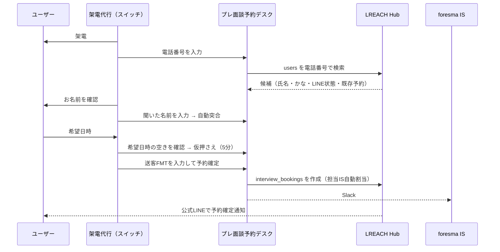

# プレ面談予約デスク（架電代行向け）設計書

メタ情報
- タイトル: プレ面談予約デスク（架電代行向け）設計書
- 目的: 架電代行（スイッチ社）が、通話中にユーザーを電話番号で特定し、名前を突合したうえで、foresma側のプレ面談枠をその場で予約できるようにする
- 対象読者: foresma IS / CS、開発担当、スイッチ社の運用責任者
- 想定シーン: 架電中のプレ面談日程確保、再電話の管理、Slackトスアップの置き換え
- タグ: #プレ面談 #架電代行 #スイッチ #UIUX #予約
- 最終更新: 2026-10-14

プロトタイプ: `プレ面談予約_架電代行.html`（同じフォルダ。ブラウザで開くと動作します。データは架空のサンプル）

---

## 1. 要約

- **いまの問題**: スイッチ社が架電で「面談候補日程」をもらっても、foresma側のIS枠が空いておらず、ユーザーに再度電話して日程を取り直している。
- **原因**: 架電代行からIS枠の空きが見えない。トスアップ（Slack）は「取れた日時」を後から伝えるだけで、その時点で枠を押さえていない。本人確認も名前の目視のみ。
- **解決**: 架電代行が使う予約画面を用意し、通話中に以下を1画面で完了させる。
  1. 電話番号でLINE登録済みユーザーを特定
  2. 電話口で聞いた名前と登録名を自動突合（一致／名字のみ一致／不一致）
  3. IS担当の空き枠をリアルタイムで見て、その場で仮押さえ（5分）
  4. 送客FMTの項目を入力して予約確定 → 担当IS自動割当・Slack文面自動生成
  5. 予約に至らない場合は「再電話／既往歴／時期NG／不通／対象外」を記録

---

## 2. 現状フロー（Slackの実態）

| チャンネル | 投稿者 | 内容 | 課題 |
|---|---|---|---|
| #調整-foresma-スイッチ | スイッチ社 | 「こちら取得済みです！」＋【送客FMT】（候補日程・面談方法・氏名・電話番号・経歴など約25項目）＋紹介コメント | 日程は「取った後」に共有。IS枠と衝突すると取り直し |
| #面談調整-スイッチさん | スイッチ社 | 「・名前：◯◯／・再電話：YYYY/MM/DD HH:MM」「既往歴」「時期NG」 | 再電話の予定がSlackに流れるだけで、期限管理・重複管理ができない |
| #面談調整-スイッチさん | Winova | 前日分のプレ面談未実施リスト（スプレッドシート） | 予約と実施の突合が手作業 |

---

## 3. 新フロー

---

## 4. 画面構成

| 画面 | 目的 | 主な要素 |
|---|---|---|
| 架電・予約（メイン） | 通話中に予約まで完了する | STEP1 電話番号検索／STEP2 名前突合／STEP3 空き枠と仮押さえ／STEP4 送客FMT入力・予約確定／予約に至らなかった場合の報告 |
| 再電話リスト | 再電話の期限管理 | 時刻順、超過は赤・1時間以内は黄、「架電する」で即メイン画面に読み込み |
| 予約一覧 | 自分や全体の予約確認・キャンセル | これから／自分が取った予約／すべて、キャンセル（画面内で確認） |
| 空き状況 | 今後7日の混雑を俯瞰 | 日×時間のヒートマップ。押すとその日時の枠選択へ |

### STEP1 ユーザー特定
- 入力: 電話番号（ハイフン・全角・+81 を自動で正規化）または下4桁。
- 結果カード: 氏名・かな・LINE表示名・登録日・お住まい、状態タグ。
- 状態タグ（優先度順）
  - 赤: **予約済み**（二重予約防止）、**LINEブロック**（確定通知が届かない）
  - 黄: **同一番号あり**（家族共用など。複数ヒット時は名前で選ぶ）、**過去に既往歴／時期NG**
  - 青: **再電話予定**（予約すると自動で完了扱い）
- 0件: 聞き間違いの復唱を促し、LINE友だち追加を案内して再電話で登録。

### STEP2 名前突合
- 聞いた名前を漢字・ひらがな・カタカナいずれでも入力可。空白・全半角・カナ/かなの差は吸収して比較。
- 判定
  - ○ 一致（氏名 or かなが一致）→ 進める
  - △ 名字のみ一致 → 生年月日が一致すれば○に昇格
  - × 不一致 → 進めない
- △/×でも、旧姓登録などで本人と確認できた場合は「確認した内容」を書けば進める（理由はSlack文面と予約に記録）。

### STEP3 空き枠
- 1枠30分、開始15分刻み、9:00〜22:00、今日から7日間。開始30分前を切った枠は受付終了。
- 残数＝その時間に勤務中で予定のないIS人数。残2以上は通常表示、残1は黄枠、満枠・受付終了は灰色の破線。
- **「ユーザーが言った時間、空いてる？」**: 希望日時を入れると○×を即答。×なら前後の近い空きを4つ提案し、そのまま仮押さえできる。
- **トーク例**: 直近の空き3枠を読み上げ用の文章で表示。
- **仮押さえ**: 枠を押すと5分間確保（タイマー表示）。本番ではサーバー側でロックし、他の架電担当には満枠として見せる。期限切れで自動解除。

### STEP4 送客FMT・予約確定
- 項目は現行の【送客FMT】と同じ。ユーザー登録情報から氏名・かな・生年月日・電話・お住まい・希望勤務地・転職時期を自動入力。
- 必須: 面談方法、名前、ふりがな、生年月日、お住まい、希望勤務地、既往歴確認、転職希望時期。経歴・紹介コメントは折りたたみで任意。
- 既往歴「あり」を選ぶと注意表示（運用上、予約せず「既往歴」報告にする場合があるため）。
- 予約ボタンは「ユーザー選択済み・突合OK・枠仮押さえ済み・必須入力済み」になるまで押せず、足りないものを文章で表示。
- 確定時: 当日の担当件数が少ないISを自動割当 → プレ面談ID発行 → Slack文面を生成（現行FMT互換＋末尾にプレ面談ID・担当IS・予約者）。

### 予約に至らなかった場合
- 再電話（日時指定）／既往歴／時期NG／不通／対象外を選ぶと、現行の「・名前：◯◯／・再電話：YYYY/MM/DD HH:MM」形式の文面を生成し記録。
- 再電話は再電話リストに入る。同じユーザーの古い再電話予定は自動で完了扱い。

---

## 5. データ連携（本番化）

既存のSupabase（ohno_project）にあるLREACH Hubの写しと突合の仕組みを流用する。

| 用途 | 参照・書き込み先 | 備考 |
|---|---|---|
| ユーザー検索 | LREACH Hub `users`（写し: `hub_users`） | 電話番号は写しに保存していないため、検索はHub側APIで行い、画面には必要最小限のみ返す |
| 同一番号判定 | `hub_users.phone_dup` | 「同一番号あり」タグ |
| LINEブロック | `hub_users.is_blocked` / `blocked_at` | 「LINEブロック」タグ |
| 既存プレ面談 | Hub `interview_bookings`（写し: `hub_pre_interviews` / `core_pre_interviews`） | 予約済み判定・二重予約防止 |
| IS担当 | `hub_staff`（`is_external_partner` で外部を除外） | シフトは新規テーブル（下記） |
| トスアップ突合 | `tossup_links`（`phone_last4`, `matched_by`）・`tossup_info` | 現行Botの突合ロジックを流用。予約時に `matched_by = 'booking_desk'` で記録 |
| Slack投稿 | slack-thread-forwarder と同じBot | #調整-foresma-スイッチ に自動投稿 |

### 新規テーブル案

| テーブル | 主な列 | 用途 |
|---|---|---|
| `is_shifts` | staff_id, date, start_time, end_time | IS勤務枠（Googleカレンダー連携も可） |
| `slot_holds` | id, slot_start, staff_id, operator_id, expires_at | 5分仮押さえ。`expires_at` 超過で無効。予約確定時に削除 |
| `call_outcomes` | id, user_id, type（再電話/既往歴/時期NG/不通/対象外）, callback_at, operator_id, memo, done | 架電結果と再電話リスト |
| `booking_desk_audit` | id, user_id, operator_id, spoken_name, verdict, override_reason, booking_id, created_at | 本人確認の記録（突合の証跡） |

- 二重予約防止: 予約作成はDB関数（トランザクション）で「シフト内・予定なし・ホールド本人」を確認してから `interview_bookings` を作成。
- 個人情報: スイッチ社に返すのは氏名・かな・電話（入力した番号と一致時のみ）・LINE状態・お住まい程度。経歴など既存トスアップ情報の閲覧はforesma側権限のみ。

---

## 6. ログイン・権限（次フェーズ）

| ロール | できること |
|---|---|
| 架電代行（スイッチ社） | 検索・突合・予約・自分の予約のキャンセル・架電結果記録・再電話リスト |
| 架電代行 管理者 | 上記＋自社メンバー全員の予約・実績閲覧、メンバー招待 |
| foresma IS / 管理者 | 全予約閲覧・担当変更・シフト管理・監査ログ閲覧 |

- 招待制（`wellcareer_members` と同様の仕組み）＋Supabase Auth（メールリンク or Google）。
- 画面右上の「架電担当」選択はログインユーザーに置き換える。
- RLSで会社単位にデータを分離。

---

## 7. 効果指標

| 指標 | 現状の測り方 | 目標 |
|---|---|---|
| 日程取り直し件数 | 再電話のうち「枠なし」由来 | ほぼ0 |
| 架電→プレ面談予約率 | トスアップ数 / 架電数 | 向上 |
| プレ面談実施率 | Winova未実施リストとの突合 | 向上（本人確認の徹底で誤登録減） |
| 再電話の期限超過率 | 再電話リストの超過件数 | 10%未満 |

---

## 8. 次にやること

- [ ] スイッチ社の運用担当にプロトタイプを触ってもらい、項目・文言をすり合わせ
- [ ] IS勤務シフトの持ち方を決める（Googleカレンダー連携 or 管理画面入力）
- [ ] 既往歴あり・時期NGを「予約不可」にするかの運用ルール決定
- [ ] Hubのユーザー検索API（電話番号）と予約作成API（トランザクション）の実装
- [ ] ログイン（招待制）とRLSの実装
- [ ] Slack自動投稿をslack-thread-forwarderに追加し、手動トスアップを段階的に廃止
