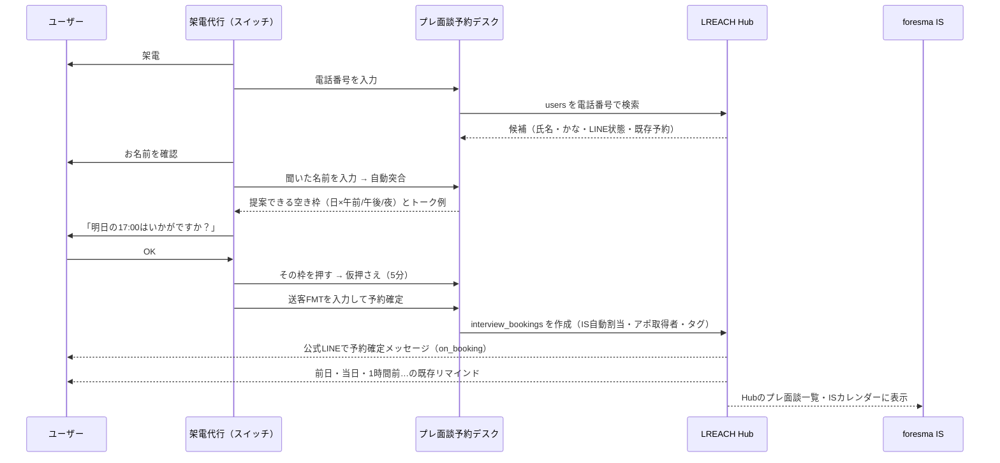

# プレ面談予約デスク（架電代行向け）設計書

メタ情報
- タイトル: プレ面談予約デスク（架電代行向け）設計書
- 目的: 架電代行（スイッチ社）が、通話中にユーザーを電話番号で特定し、名前を突合したうえで、foresma側のプレ面談枠をその場で予約できるようにする
- 対象読者: foresma IS / CS、開発担当、スイッチ社の運用責任者
- 想定シーン: 架電中のプレ面談日程確保、再電話の管理、Slackトスアップの置き換え
- タグ: #プレ面談 #架電代行 #スイッチ #UIUX #予約
- 最終更新: 2026-10-14（v6: 予約をHubの interview_bookings に登録）

プロトタイプ: `プレ面談予約_架電代行.html`（同じフォルダ。ブラウザで開くと動作します。データは架空のサンプル）

---

## 1. 要約

- **いまの問題**: スイッチ社が架電で「面談候補日程」をもらっても、foresma側のIS枠が空いておらず、ユーザーに再度電話して日程を取り直している。
- **原因**: 架電代行からIS枠の空きが見えない。トスアップ（Slack）は「取れた日時」を後から伝えるだけで、その時点で枠を押さえていない。本人確認も名前の目視のみ。
- **解決**: 架電代行が使う予約画面を用意し、通話中に以下を1画面で完了させる。
  1. 電話番号でLINE登録済みユーザーを特定
  2. 電話口で聞いた名前と登録名を自動突合（一致／名字のみ一致／不一致）
  3. **自社の空き枠を架電代行から提案**（「明日の17:00はいかがですか？」）し、決まった枠をその場で仮押さえ（5分）
  4. 送客FMTの項目を入力して予約確定 → 担当IS自動割当・**ユーザーへ確定メッセージ自動送信**・**LREACH Hubにプレ面談として登録**
  5. 予約に至らない場合は「再電話／既往歴／時期NG／不通／対象外」を記録

---

## 2. 現状フロー（Slackの実態）

| チャンネル | 投稿者 | 内容 | 課題 |
|---|---|---|---|
| #調整-foresma-スイッチ | スイッチ社 | 「こちら取得済みです！」＋【送客FMT】（候補日程・面談方法・氏名・電話番号・経歴など約25項目）＋紹介コメント | 日程は「取った後」に共有。IS枠と衝突すると取り直し |
| #面談調整-スイッチさん | スイッチ社 | 「・名前：◯◯／・再電話：YYYY/MM/DD HH:MM」「既往歴」「時期NG」 | 再電話の予定がSlackに流れるだけで、期限管理・重複管理ができない |
| #面談調整-スイッチさん | Winova | 前日分のプレ面談未実施リスト（スプレッドシート） | 予約と実施の突合が手作業 |

---

## 3. 新フロー

---

## 4. 画面構成

| 画面 | 目的 | 主な要素 |
|---|---|---|
| 架電・予約（メイン） | 通話中に予約まで完了する | STEP1 電話番号検索／STEP2 名前突合／STEP3 空き枠と仮押さえ／STEP4 送客FMT入力・予約確定／予約に至らなかった場合の報告 |
| 再電話リスト | 再電話の期限管理 | 時刻順、超過は赤・1時間以内は黄、「架電する」で即メイン画面に読み込み |
| 予約一覧 | 自分や全体の予約確認・キャンセル | これから／自分が取った予約／すべて、キャンセル（画面内で確認） |
| 空き状況 | 今後7日の混雑を俯瞰 | 日×時間のヒートマップ。押すとその日時の枠選択へ |

### STEP1 ユーザー特定
- 入力: 電話番号（ハイフン・全角・+81 を自動で正規化）または下4桁。
- 結果カード: 氏名・かな・LINE表示名・登録日・お住まい、状態タグ。
- 状態タグ（優先度順）
  - 赤: **予約済み**（二重予約防止）、**LINEブロック**（確定通知が届かない）
  - 黄: **同一番号あり**（家族共用など。複数ヒット時は名前で選ぶ）、**過去に既往歴／時期NG**
  - 青: **再電話予定**（予約すると自動で完了扱い）
- 0件: 聞き間違いの復唱を促し、LINE友だち追加を案内して再電話で登録。

### STEP2 名前突合
- 聞いた名前を漢字・ひらがな・カタカナいずれでも入力可。空白・全半角・カナ/かなの差は吸収して比較。
- 判定
  - ○ 一致（氏名 or かなが一致）→ 進める
  - △ 名字のみ一致 → 生年月日が一致すれば○に昇格
  - × 不一致 → 進めない
- △/×でも、旧姓登録などで本人と確認できた場合は「確認した内容」を書けば進める（理由はSlack文面と予約に記録）。

### STEP3 枠を提案して押さえる（メインの流れ）
- **いま提案できる枠**: 今日から順に、各日の「午前・午後・夜」で一番早い空きを最大6枠カードで表示。架電代行はこれを読み上げて「ここどうですか？」と聞くだけ。
- **時間帯で絞る**: ユーザーが「夜がいい」「土日がいい」と言ったら、午前／午後／夜／土日のボタンで提案を入れ替える。
- **トーク例**: 提案の上位3枠と名字を入れた読み上げ文を表示（例：「山田様、直近ですと、今日の17:00、明日の17:00…でお時間をお取りできます」）。
- **ほかの日時から選ぶ**（折りたたみ）: 7日分の全枠を日付タブ×30分刻みで表示。
- **ユーザーから日時を指定されたら**（折りたたみ）: 希望日時を入れると○×を即答。×なら近い空きを提案。
- 面談15分・枠は30分刻み、9:00〜22:00、今日から7日間（Hubの出会えるエージェント予約フォームと空き枠計算に合わせた）。開始30分前を切った枠は受付終了。
- 残数＝その時間に勤務中で予定のないIS人数。残1は黄色、満枠・受付終了は灰色。
- **仮押さえ**: 枠を押すと5分間確保（タイマー表示）。本番ではサーバー側でロックし、他の架電担当には満枠として見せる。期限切れで自動解除。

### STEP3 カレンダー表示（v4）
- 「おすすめ枠／カレンダー」を切り替えられる。カレンダーは7日×30分のマス目で、各マスに空いているISの人数を表示（2名以上＝緑、1名＝黄、満枠・受付終了＝灰）。
- マスを押すとその枠を5分間仮押さえ。「空き状況」タブのヒートマップから押した場合もカレンダーのその時間に移動する。

### STEP4 予約確定とトスアップ（v4）
- **予約に必要なのは「本人確認・枠・名前」だけ。** トスアップ（送客FMT）の項目は未入力でも予約できる。ボタンは未入力があると「予約だけ確定する（トスアップは後で）」、全部入っていると「予約を確定してトスアップする」になる。
- 未入力で予約した人は **「トスアップ待ち」タブ** に入る（未件数をタブにバッジ表示）。「トスアップする」から項目を入れると、Slack用の送客FMTができてトスアップ済みになる。済みのものは「見直す」から直せる。
- **送客FMTの貼り付け読み込み**：「【送客FMT】」〜「【その他】」をそのまま貼り付けると、各項目（名前・ふりがな・性別・生年月日・アドレス・お住まい・希望勤務地・学歴・就業状況・雇用形態・経験社数・年数・職種・希望職種・NG職種・年収・希望年収・転職時期・お子様・既往歴・紹介コメント・使用中エージェント・その他）に振り分ける。生年月日は「2000年12月3日」も読める。電話番号が選択中のユーザーと違うときは警告する。
- トスアップに必要な項目：名前・ふりがな・生年月日・お住まい・希望勤務地・転職希望時期。

### 予約に至らなかった場合のメモ（v4）
- 結果（再電話／既往歴／時期NG／不通／対象外）に加えて、**通話の状況**（本人と話せた・留守電に残した・出なかった・途中で切れた・本人以外が出た・番号が使われていない）、**次に連絡しやすい時間帯**、**詳しいメモ**を残せる。
- Slackの報告文に「・状況／・連絡しやすい時間／・メモ」を入れるかを選べる。
- メモは再電話リストと、次に同じ人を検索したときの注意表示に出る。

### 予約確定メッセージ（LINE予約と同じ）
LINE予約で届いている確定メッセージ（Hub `interview_booking_reminders` の `on_booking`、リマインド種別 電話＝8／オンライン＝9）とまったく同じものを送る。画面の完了表示もこの3通をそのまま再現している。

1. **Flexカード「出会えるエージェント 予約内容」**
   - 「{名前}さん【出会えるエージェントのご案内】のご予約ありがとうございます✨ 日程が近づいてまいりましたら改めてご連絡いたします！🙇‍♀️」
   - 【予約内容】出会えるエージェントのご案内／【案内方法】電話 or オンライン面談／【予約日時】10月15日（木）13:00
   - 電話：「※ご予約日時になりましたら『担当コンサルタント』よりお電話差し上げます！」／オンライン：面談リンク
   - 「当日は{名前}さんの ✅今のお悩みや不安 ✅転職希望条件 ✅理想の将来設計 など…最大3社ご案内させていただきます✨」
2. **テキスト**「ご予約完了いたしました！…①サービス説明動画（1分）…②事前ヒアリングシート…」
3. **テキスト**「※このメッセージをコピーしてご記載ください！」（事前ヒアリングシート）

その後のリマインド（前日12:03・当日8:03・1時間前・30分前・10分前など）もLINE予約と同じ設定で届く。

### LINEに届かない人へのSMS（友だち追加URL）
| 状況 | いつ | SMSの内容 |
|---|---|---|
| 電話番号がHubに無い（LINE未登録） | STEP1で見つからなかったとき | 公式LINEの友だち追加URL |
| LINE未追加（`is_line_added=false`） | STEP2 | 友だち追加URL |
| LINEブロック中（`is_blocked=true`） | STEP2・予約確定時 | 予約日時＋LINE再追加URL |

- 本文は画面で編集でき、文字数と通数（70文字で1通）を表示する。
- 友だち追加URLは画面上部の設定に入れる（DBに保存されていなかったため）。
- 送信はHubのSMS送信の仕組み（`sms_messages` に送信履歴あり）とつなぐ想定。

### Hubでの表示
予約は `interview_bookings` に1行作るので、Hubのプレ面談一覧・ISの予定・着座集計（winova判定、着座率）にそのまま乗る。

| interview_bookings の列 | 入れる値 |
|---|---|
| users_id / line_user_id | STEP1で特定したユーザー |
| start_at / end_at | 選んだ枠（15分） |
| form_id | 出会えるエージェント エージェント相談（電話 or オンライン面談） |
| reminder_type_id | 電話＝8／オンライン＝9 |
| is_staff_id | 自動割当したIS（`is_staff_assignment_settings` の優先度・1日上限に従う） |
| appointment_getter_id | 架電した人（スイッチ社の担当を `is_staff` に外部パートナーとして登録） |
| tag | `架電代行_スイッチ`（既存の `架電引き上げ_スイッチ` に寄せるかは要確認） |
| memo | 本人確認メモ（名前不一致で進めた場合の理由） |
| status_id | 予約確定 |

### 予約に至らなかった場合
- 再電話（日時指定）／既往歴／時期NG／不通／対象外を選ぶと、現行の「・名前：◯◯／・再電話：YYYY/MM/DD HH:MM」形式の文面を生成し記録。
- 再電話は再電話リストに入る。同じユーザーの古い再電話予定は自動で完了扱い。

---

## 5. 実データ接続（v3で実装済み）
プロトタイプは、claude.ai 上で開くと**閲覧者自身のSupabase接続**（コネクタ）を使い、次のSQLを読み取り専用で実行して実データを表示する。ページにはデータを埋め込んでいない。Supabaseにつながらない環境では架空のデモデータに切り替わる。

| 画面 | 読み込むデータ（プロジェクト） |
|---|---|
| STEP1 ユーザー検索 | Hub `user_profiles` × `users`（電話番号・名前・LINE名・生年月日・お住まい・希望勤務地・ブロック／LINE追加状態）、同じ番号の登録数、直近5件の `interview_bookings` |
| STEP2 トスアップ履歴 | `tossup_info`（Slackトスアップの取込。IS名・総合評価・紹介文・Slackリンク） |
| STEP3 空き枠 | Hub `slot_capacity_logs`（brand=deaeru, scope=full の最新。5分ごとに計算、30分刻み・空きIS名つき） |
| IS自動割当 | Hub `is_staff` × `is_staff_assignment_settings`（有効なISを優先度順） |
| Hubの予約一覧 | Hub `interview_bookings`（アポ取得者＝「スイッチ」またはタグに「スイッチ」を含む） |

**まだ書き込まないもの**：予約登録・確定メッセージ送信・SMS送信。予約は画面に「実行するSQL」と「届くメッセージ」を表示するところまで。理由は、確定メッセージの送信がDBトリガーではなくHubアプリ側の処理のため、DBに直接 insert しても確定メッセージが届かないこと（`interview_bookings` には枠数チェック `enforce_interview_booking_slot_capacity` などのトリガーはある）。本番はHubの予約API（LINE予約と同じ処理）を呼ぶ形にする。

### 予約はHubの interview_bookings に登録（v6）
スイッチが1次の電話で話し、ISとのプレ面談を予約する。プレ面談の正本はHubの `interview_bookings` なので、予約確定でそこに直接1行入れる。

| 列 | 値 |
|---|---|
| title | 【電話面談】{名前}様　出会えるエージェント ／ 【オンライン面談】{名前}様　出会えるエージェント（LINE予約と同じ形） |
| start_at / end_at | 選んだ枠 ／ +15分 |
| form_id | 出会えるエージェント エージェント相談（電話 787091ef… ／ オンライン 35c8040f…） |
| reminder_type_id | 電話＝8 ／ オンライン＝9 |
| line_user_id / users_id | STEP1で特定したユーザー |
| is_staff_id | **空欄**（Hubの自動割当に任せる。LINE予約でも登録から約17秒で割り当てられている） |
| appointment_getter_id | is_staff「スイッチ」 |
| tag / memo | 架電代行_スイッチ ／ 架電した担当者名・本人確認メモ |

- 満席はHubのトリガー `enforce_interview_booking_slot_capacity` が最終判定し、上限を超える登録は拒否される（画面は「満席になりました」と表示して別の枠へ）。
- 登録後、画面は約90秒間 Hub を見て「IS割当・Googleカレンダー・面談URL（オンライン）・確定メッセージ（on_booking）」が済んだかを表示する。
- 確定メッセージを送るDBトリガーや定期ジョブはHub DBに見当たらず、Hubアプリ側の処理と思われる。**初回の本番登録で、確定メッセージが自動で届くかを必ず確認する**（届かなければ「未」と表示される）。
- `desk_bookings` はトスアップと予約の控え（`hub_booking_id` で紐づく）。Hubに書けなかったときだけ `hub_status=draft`（Hub未登録）として残す。
- 本番で動かすには、Supabase接続に Hub の `interview_bookings` への INSERT 権限が必要（今の接続は読み取り専用で、INSERT は permission denied）。

### 共有保存（v5）
予約・トスアップ・再電話・架電メモ・仮押さえ・設定は、Supabase **ohno_project** の4テーブルに保存し、開いている全員で共有する（30秒ごとに同期）。Hub（lreach_hub）には書き込まない。

| テーブル | 中身 |
|---|---|
| `desk_bookings` | 予約（日時・方法・IS・予約者・本人確認メモ）とトスアップ（`fmt`・`tossed`）。`hub_status=draft` はHub未登録 |
| `desk_call_logs` | 予約に至らなかった結果・通話状況・連絡しやすい時間・メモ・再電話日時 |
| `desk_slot_holds` | 5分の仮押さえ。押す瞬間にDBで空きを数え直して取り合いを防ぐ |
| `desk_settings` | SMSで送るLINE友だち追加URL など |

- 空き枠＝Hubの空きIS数 −（他の担当の有効な仮押さえ）−（同時刻のHub未登録予約）。
- 共有テーブルがない／コネクタが読み取り専用のときは、自動でブラウザ内保存に切り替えて画面上部に理由を出す。
- 図解は `プレ面談予約デスク_仕様図.html`。

## 6. データ連携（本番化）

既存のSupabase（ohno_project）にあるLREACH Hubの写しと突合の仕組みを流用する。

| 用途 | 参照・書き込み先 | 備考 |
|---|---|---|
| ユーザー検索 | LREACH Hub `users`（写し: `hub_users`） | 電話番号は写しに保存していないため、検索はHub側APIで行い、画面には必要最小限のみ返す |
| 同一番号判定 | `hub_users.phone_dup` | 「同一番号あり」タグ |
| LINEブロック | `hub_users.is_blocked` / `blocked_at` | 「LINEブロック」タグ |
| 既存プレ面談 | Hub `interview_bookings`（写し: `hub_pre_interviews` / `core_pre_interviews`） | 予約済み判定・二重予約防止・**予約の書き込み先** |
| 空き枠 | Hubの空き枠計算（`slot_capacity_logs` に出ている staffed / booked / available と同じロジック） | 30分刻み。自前で計算せずHubと同じ値を使う |
| IS担当 | Hub `is_staff` / `is_staff_assignment_settings`（優先度・1日上限） | 自動割当はHubの割当ロジックを使う |
| 確定メッセージ・リマインド | Hub `interview_booking_reminders`（reminder_type 8/9） | 予約作成で自動送信 |
| トスアップ突合 | `tossup_links`（`phone_last4`, `matched_by`）・`tossup_info` | 現行Botの突合ロジックを流用。予約時に `matched_by = 'booking_desk'` で記録 |
| Slack投稿 | slack-thread-forwarder と同じBot | #調整-foresma-スイッチ に自動投稿 |

### 新規テーブル案

| テーブル | 主な列 | 用途 |
|---|---|---|
| `slot_holds` | id, slot_start, staff_id, operator_id, expires_at | 5分仮押さえ。`expires_at` 超過で無効。予約確定時に削除 |
| `call_outcomes` | id, user_id, type（再電話/既往歴/時期NG/不通/対象外）, callback_at, operator_id, memo, done | 架電結果と再電話リスト |
| `booking_desk_audit` | id, user_id, operator_id, spoken_name, verdict, override_reason, booking_id, created_at | 本人確認の記録（突合の証跡） |

- 二重予約防止: 予約作成はDB関数（トランザクション）で「シフト内・予定なし・ホールド本人」を確認してから `interview_bookings` を作成。
- 個人情報: スイッチ社に返すのは氏名・かな・電話（入力した番号と一致時のみ）・LINE状態・お住まい程度。経歴など既存トスアップ情報の閲覧はforesma側権限のみ。

---

## 7. ログイン・権限（次フェーズ）

| ロール | できること |
|---|---|
| 架電代行（スイッチ社） | 検索・突合・予約・自分の予約のキャンセル・架電結果記録・再電話リスト |
| 架電代行 管理者 | 上記＋自社メンバー全員の予約・実績閲覧、メンバー招待 |
| foresma IS / 管理者 | 全予約閲覧・担当変更・シフト管理・監査ログ閲覧 |

- 招待制（`wellcareer_members` と同様の仕組み）＋Supabase Auth（メールリンク or Google）。
- 画面右上の「架電担当」選択はログインユーザーに置き換える。
- RLSで会社単位にデータを分離。

---

## 8. 効果指標

| 指標 | 現状の測り方 | 目標 |
|---|---|---|
| 日程取り直し件数 | 再電話のうち「枠なし」由来 | ほぼ0 |
| 架電→プレ面談予約率 | トスアップ数 / 架電数 | 向上 |
| プレ面談実施率 | Winova未実施リストとの突合 | 向上（本人確認の徹底で誤登録減） |
| 再電話の期限超過率 | 再電話リストの超過件数 | 10%未満 |

---

## 9. 確認したいこと

| # | 質問 | 状況 |
|---|---|---|
| 1 | 確定メッセージ | **決定**：LINE予約と同じ（on_booking）に統一 |
| 2 | LINEに届かない人 | **決定**：SMSでLINE友だち追加URLを送る |
| 3 | 公式LINEの友だち追加URL（lin.ee など）はどれを使うか | 未回答（DBに無いため、画面の設定欄に入れる） |
| 4 | SMSはHubのどの仕組みで送るか（`sms_messages` の broadcast と同じ送信元でよいか） | 未回答 |
| 5 | 予約登録はHubの予約API（LINE予約と同じ処理）を呼んでよいか。APIの場所・認証 | 未回答 |
| 6 | アポ取得者は既存の is_staff「スイッチ」でよいか（担当者個人は memo に残す） | 仮：「スイッチ」 |
| 7 | タグは `架電代行_スイッチ` を新設するか、既存の `架電引き上げ_スイッチ` を使うか | 仮：新設 |
| 8 | 架電代行に見せる枠はLINE予約と同じ枠でよいか（上限なし） | 仮：同じ枠 |
| 9 | 既往歴あり・時期NGは予約不可にするか | 仮：注意表示のみ |
| 10 | 共有データの保存先 | **決定**：Supabase ohno_project の `desk_*` テーブル（作成SQL：`プレ面談予約デスク_共有テーブル.sql`）。Supabaseコネクタの読み取り専用を解除してもらう必要あり |

## 10. 次にやること

- [ ] スイッチ社の運用担当にプロトタイプを触ってもらい、項目・文言をすり合わせ
- [ ] 下の「確認したいこと」に回答をもらう
- [ ] 既往歴あり・時期NGを「予約不可」にするかの運用ルール決定
- [ ] Hubのユーザー検索API（電話番号）と予約作成API（トランザクション）の実装
- [ ] ログイン（招待制）とRLSの実装
- [ ] Slack自動投稿をslack-thread-forwarderに追加し、手動トスアップを段階的に廃止
